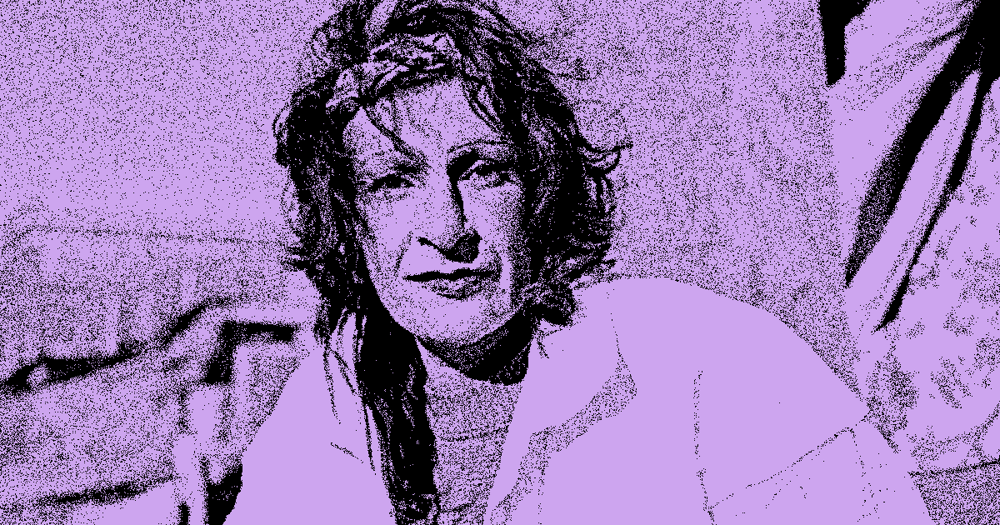

# Photocopy

A browser tool for making photocopy-style collage illustrations.

## Use it

1. Go to [photocopy.namesake.fyi](https://photocopy.namesake.fyi).
2. **Upload, drop, or paste** an image, or **search for images** to find openly licensed photos from Wikimedia and other sources.
3. Use the toolbar to **Remove Background** automatically. If the automatic removal isn't great, use the **Mask** brushes to add or remove parts of the image.
4. Modify **Appearance** settings like **Ink** and **Grain** to taste.
5. Press **Export** (or ⌘E / Ctrl+E), then **Download PNG**.

Work is saved in the browser as you go.

## Scripts

- `pnpm dev`: start the app
- `pnpm build`: type-check and build a static site into `dist/`
- `pnpm test`: run the pipeline tests
- `pnpm check`: lint and format with Biome
- `pnpm changeset`: describe your change for the changelog

## Credits

This tool would not be possible without:

- [@imgly/background-removal](https://github.com/imgly/background-removal-js)
- [Konva](https://konvajs.org) and [react-konva](https://github.com/konvajs/react-konva)
- [React Aria Components](https://react-spectrum.adobe.com/react-aria/)
- Openly licensed images from the public APIs for:
  - [Wikimedia Commons](https://commons.wikimedia.org)
  - [Art Institute of Chicago](https://www.artic.edu/open-access/public-api)
  - [SMK – National Gallery of Denmark](https://open.smk.dk)
  - [Wellcome Collection](https://wellcomecollection.org)

If this tool helps you, please consider donating to [support Namesake](http://namesake.fyi/donate).

## Accessibility

Namesake aims to conform to the Level AA accessibility standards outlined in the [WCAG 2.2 specification](https://www.w3.org/TR/WCAG22/). If you experience an issue with accessing any part of this site, please [file an issue](https://github.com/namesakefyi/photocopy/issues) and we will correct it.

## License

This repository is licensed under [AGPL-3.0](LICENSE.md).
